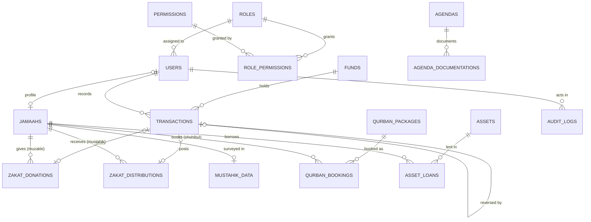

# Amami — Database

PostgreSQL schema for amami. It is generated from the GORM models in `backend/internal/domain/models.go` by `AutoMigrate` on every server start; there are no migration files. This document describes what that produces.

## Conventions

- **Keys.** Records people create (users, jamaah, transactions, zakat, qurban bookings and animals, assets, agendas) use `UUID` keys from `gen_random_uuid()`. Lookup tables (roles, permissions, funds, qurban packages, settings, audit logs) use integer keys.
- **Money** is `BIGINT` whole rupiah. Zakat amounts are `DECIMAL(12,2)` because they can be rice in kilograms; only whole-rupiah IDR amounts reach the ledger.
- **Enums** are `VARCHAR` columns. The allowed values live in `domain/enums.go` and are enforced by request validation, not by database constraints.
- **Soft deletes.** Tables with a `deleted_at` column are never hard-deleted by the application; GORM hides those rows from normal queries. Their unique columns use *partial* unique indexes (`WHERE deleted_at IS NULL`), so a deleted value can be reused.
- **Extensions.** `pg_trgm` is created on start for fuzzy name search.

## Relationships



## Tables

### Access control

**`roles`** — `id` INT PK, `name` VARCHAR(50) UNIQUE, `description` TEXT.
Seeded values: `SUPER_ADMIN`, `BENDAHARA`, `TAKMIR`, `SEKRETARIS`, `JAMAAH`.

**`permissions`** — `id` INT PK, `code` VARCHAR(50) UNIQUE, `description` TEXT.

**`role_permissions`** — `role_id`, `permission_id` (composite PK; both cascade on delete).

`roles`, `permissions` and `role_permissions` are rewritten on every server start to match `domain.RolePermissions` (see `docs/RBAC_VIEW_MATRIX.md`). Edit grants in code, not in the database.

**`users`**

| Column | Type | Notes |
|---|---|---|
| id | UUID | PK |
| username | VARCHAR(50) | unique among live rows |
| email | VARCHAR(100) | unique among live rows |
| password_hash | TEXT | bcrypt |
| role_id | INT | FK `roles`, RESTRICT |
| status | VARCHAR(50) | `ACTIVE`, `SUSPENDED`, `PENDING_PASSWORD_CHANGE` |
| last_login_at | TIMESTAMPTZ | nullable |
| created_at, updated_at | TIMESTAMPTZ | |
| deleted_at | TIMESTAMPTZ | soft delete |

### Jamaah

**`jamaahs`** — the community registry. Not every jamaah has a user account; committee accounts each get a linked jamaah profile.

| Column | Type | Notes |
|---|---|---|
| id | UUID | PK |
| user_id | UUID | unique, FK `users`, SET NULL; nullable |
| full_name | VARCHAR(100) | GIN trigram index for search |
| phone | VARCHAR(20) | |
| address | TEXT | |
| is_mustahik | BOOLEAN | indexed; only mustahik can receive zakat |
| mustahik_score | DECIMAL(5,2) | 0-100 poverty score, indexed for sorting |
| created_at, updated_at | TIMESTAMPTZ | |
| deleted_at | TIMESTAMPTZ | soft delete |

**`mustahik_data`** — the latest needs survey per jamaah (one row each, upserted).

| Column | Type | Notes |
|---|---|---|
| id | UUID | PK |
| jamaah_id | UUID | unique, FK `jamaahs`, RESTRICT |
| total_income | BIGINT | monthly household income, IDR |
| dependents_count | INT | |
| house_status | VARCHAR(50) | `OWNED`, `FAMILY`, `RENTED`, `NONE` |
| has_disability | BOOLEAN | |
| criteria_notes | TEXT | |
| surveyed_by | UUID | FK `users`, SET NULL |
| updated_at | TIMESTAMPTZ | |

Saving a survey recalculates `jamaahs.mustahik_score` in the same database transaction.

### Finance

**`funds`** — `id` INT PK, `name` VARCHAR(100), `code` VARCHAR(20) UNIQUE, `current_balance` BIGINT, `created_at`, `updated_at`.

**`transactions`** — the ledger. Rows are only ever inserted.

| Column | Type | Notes |
|---|---|---|
| id | UUID | PK |
| fund_id | INT | FK `funds`, RESTRICT |
| type | VARCHAR(10) | `CREDIT` (in) or `DEBIT` (out) |
| amount | BIGINT | `CHECK (amount > 0)` |
| category | VARCHAR(30) | indexed; reversals use `REVERSAL` |
| description | VARCHAR(255) | |
| reference_id | UUID | optional link to a related record |
| reversal_of_id | UUID | **unique**; set on a reversal entry, pointing at the transaction it cancels |
| metadata | JSONB | structured extras |
| created_by | UUID | FK `users`, RESTRICT |
| created_at | TIMESTAMPTZ | |

Indexes: `(fund_id, created_at)`, `created_at`, `category`, `reference_id`, `created_by`, unique `reversal_of_id`.

The unique index on `reversal_of_id` is what guarantees a transaction can be reversed at most once, even under concurrent requests.

### Zakat

**`zakat_donations`** — zakat and infaq received.

| Column | Type | Notes |
|---|---|---|
| id | UUID | PK |
| transaction_id | UUID | FK `transactions`, RESTRICT; set when cash was posted to a fund |
| muzakki_id | UUID | FK `jamaahs`, RESTRICT |
| zakat_type | VARCHAR(30) | `FITRAH_BERAS`, `MAAL`, `INFAQ` |
| amount | DECIMAL(12,2) | |
| unit | VARCHAR(20) | `IDR`, `KG`, `LITER` |
| description | TEXT | |
| metadata | JSONB | |
| created_at | TIMESTAMPTZ | |

**`zakat_distributions`** — aid given to mustahik. Same shape, with `mustahik_id` (FK `jamaahs`) instead of `muzakki_id`, and `distributed_at` instead of `created_at`.

Zakat rows have no `deleted_at`: they are part of the financial record and are never removed.

### Qurban

**`qurban_packages`** — `id` INT PK, `name`, `type` (`KAMBING`, `DOMBA`, `SAPI`, `SAPI_KOLEKTIF`), `price` BIGINT, `year_hijri` INT (indexed), `stock_total` INT, `stock_remaining` INT `CHECK (>= 0)`, `deleted_at`.

**`qurban_bookings`** — `id` UUID PK, `shohibul_id` FK `jamaahs`, `package_id` FK `qurban_packages`, `booking_date`, `payment_status` (`PENDING`, `PAID`), `total_amount` BIGINT (copied from the package price at booking time), `metadata` JSONB.

**`qurban_animals`** — `id` UUID PK, `tag_number` VARCHAR(50) (unique among live rows), `type` (`KAMBING`, `DOMBA`, `SAPI`), `weight` DECIMAL(6,2), `status` (`AVAILABLE`, `ASSIGNED`, `SLAUGHTERED`, indexed), `vendor_info` TEXT, `deleted_at`.

### Inventory

**`assets`** — `id` UUID PK, `name` (indexed), `sku` VARCHAR(50) (unique among live rows), `purchase_date`, `purchase_price` BIGINT, `current_status`, `location`, `deleted_at`.

`current_status` is one of `GOOD`, `LOANED`, `NEEDS_REPAIR`, `REPAIR`, `BROKEN`. `LOANED` is set and cleared only by the loan workflow.

**`asset_loans`** — `id` UUID PK, `asset_id` FK `assets`, `jamaah_id` FK `jamaahs`, `loan_date`, `due_date` (nullable), `return_date` (nullable, indexed; null means still on loan), `condition_notes`.

### Agenda

**`agendas`** — weekly schedule entries.

| Column | Type | Notes |
|---|---|---|
| id | UUID | PK |
| title | VARCHAR(200) | |
| description | TEXT | |
| day | VARCHAR(20) | Indonesian day name, e.g. `Senin` |
| time | VARCHAR(20) | `HH:MM` |
| location | VARCHAR(100) | |
| status | VARCHAR(30) | `SCHEDULED`, `ONGOING`, `COMPLETED`, `CANCELLED` |
| created_by_id | UUID | FK `users`, SET NULL |
| deleted_at | TIMESTAMPTZ | soft delete |

**`agenda_documentations`** — uploaded photos and PDFs.

| Column | Type | Notes |
|---|---|---|
| id | UUID | PK |
| agenda_id | UUID | FK `agendas`, CASCADE |
| storage_key | TEXT | path inside `UPLOAD_DIR`; never sent to clients |
| file_url | TEXT | public URL under `/uploads/` |
| file_name | VARCHAR(255) | original name |
| file_type | VARCHAR(50) | detected MIME type: `image/jpeg`, `image/png`, `image/webp`, `application/pdf` |
| file_size | BIGINT | bytes |
| uploaded_by | UUID | FK `users`, SET NULL |
| uploaded_at | TIMESTAMPTZ | |

Soft-deleting an agenda keeps its documentation for the archive.

### System

**`system_settings`** — key/value store: `id` INT PK, `key` VARCHAR(50) UNIQUE, `value` TEXT, `is_secret` BOOLEAN. Holds the mosque profile (`mosque_name`, `mosque_address`, bank account, zakat fitrah amount, active Hijri year) and SMTP settings. `is_secret` marks values the API never returns (such as the SMTP password); they are **not** encrypted at rest.

**`audit_logs`** — `id` INT PK, `user_id` FK `users`, `action` (e.g. `LOGIN`, `PASSWORD_CHANGE`), `entity`, `entity_id`, `metadata`, `created_at` (indexed).

**`memos`** — `id` UUID PK, `title`, `content`, `author_id` FK `users`, `is_pinned`, `created_at`. The table exists for the planned internal memo feature; no API uses it yet.

## Integrity rules

- **Foreign keys** on financial and religious records are `RESTRICT`, so nothing that a ledger entry, zakat record or booking depends on can be hard-deleted. Links that only describe *who* did something (`surveyed_by`, `uploaded_by`, `created_by_id`, `jamaahs.user_id`) are `SET NULL`.
- **Atomic postings.** Every ledger write runs in one database transaction that locks the fund row (`SELECT ... FOR UPDATE`), rejects a debit larger than the balance, updates `current_balance`, and inserts the transaction. Zakat with a fund and reversals use the same routine, so a fund balance always equals the sum of its ledger rows.
- **Qurban bookings** lock the package row, check and decrement `stock_remaining`, and insert the booking in one transaction, so a package cannot be overbooked.
- **Loans** lock the asset, check it is `GOOD`, create the loan and mark the asset `LOANED` in one transaction; returns lock the loan, check it is still open, set `return_date` and mark the asset `GOOD` together. An asset can therefore never be lent twice or returned twice.

## Data access patterns

How the repositories (`backend/internal/repository/`) talk to the database. PostgreSQL runs at its default isolation level, `READ COMMITTED`; correctness under concurrent use comes from row locks and constraints, not from a stricter isolation level.

### Transaction boundaries

A database transaction is opened with GORM's `db.Transaction(func(tx) error { ... })`: returning an error rolls everything back, returning `nil` commits. The boundary sits in the **repository**, around exactly the rows that must change together. Services never receive a `*gorm.DB`, so they cannot widen or leak a transaction.

| Operation | Repository method | Writes in one transaction |
|---|---|---|
| Record income / expense | `finance.CreateTransaction` | fund balance + ledger row |
| Reverse a transaction | `finance.ReverseTransaction` | fund balance + reversal row |
| Collect zakat | `zakat.CollectZakat` | fund balance + ledger row (if cash) + donation |
| Distribute zakat | `zakat.DistributeZakat` | recipient share lock + fund balance + ledger row (if cash) + distribution |
| Book qurban | `qurban.CreateBooking` | package quota + booking |
| Edit qurban package | `qurban.UpdatePackage` | package row (quota checked against bookings) |
| Lend / return asset | `inventory.CreateLoan`, `ReturnLoan` | loan row + asset status |
| Edit / delete asset | `inventory.UpdateAsset`, `DeleteAsset` | asset row (loan status checked) |
| Save mustahik survey | `jamaah.SaveSurvey` | jamaah lock + survey upsert + jamaah score |
| Save mosque profile / SMTP | `settings.UpsertSettings` | all keys in one statement |
| Invite user | `user.CreateUserWithProfile` | user + linked jamaah profile |
| Delete user | `user.DeleteUser` | soft delete of jamaah profile + user |
| Sync RBAC on start | `seed.SyncRBAC` | permissions, roles, grants |

### Pessimistic locking: the ledger posting routine

Every movement of money goes through one function, `repository/finance.PostTransaction(tx, entry)`, which must be called inside a transaction:

```
SELECT * FROM funds WHERE id = $fund FOR UPDATE   -- lock the fund row
-- DEBIT larger than current_balance  -> abort with ErrInsufficientBalance
UPDATE funds SET current_balance = ... WHERE id = $fund
INSERT INTO transactions (...)
COMMIT                                            -- lock released
```

`FOR UPDATE` makes concurrent postings to the same fund wait for each other, so two expenses can never both pass the balance check against the same starting balance. Postings to different funds do not block each other. Because manual entries, reversals and both zakat flows all reuse this one routine, the rule "a fund balance equals the sum of its ledger rows" lives in exactly one place.

The lock helpers live in `pkg/database/tx.go`: `LockForUpdate[T](tx, id)` (exclusive, for rows about to change) and `LockForShare[T](tx, id)` (shared, for rows that must stay as they are while something else is written). Both must be called inside `db.Transaction`; a missing or soft-deleted row returns `gorm.ErrRecordNotFound`.

### Locked read, service rule, write

Whenever the outcome of a write depends on the current state of a row ("only a `GOOD` asset can be lent", "the quota cannot drop below the units already booked"), checking first and writing later is a race: another request can change the row in between. Rules belong in the service and atomicity in the repository, so the service passes the rule into the repository as a **callback**, and the repository runs it against the locked row:

```go
// service: a pure rule, unit-tested without a database
func newLoan(req CreateAssetLoanRequest) inventoryRepo.LoanBuilder {
    return func(asset *domain.Asset) (*domain.AssetLoan, error) {
        if asset.CurrentStatus != domain.AssetGood {
            return nil, apperror.Conflict("only assets in GOOD condition can be loaned")
        }
        return &domain.AssetLoan{AssetID: asset.ID, ...}, nil
    }
}

// repository: owns the transaction and the lock
db.Transaction(func(tx *gorm.DB) error {
    asset, err := database.LockForUpdate[domain.Asset](tx, assetID) // 1. lock
    if err != nil { return err }
    loan, err := build(asset)                                         // 2. rule
    if err != nil { return err }                                      //    rejected: roll back
    ...                                                               // 3. write
})
```

A rule that rejects returns an `apperror` value; the repository passes it through unchanged and the service returns it as is (`apperror.FromStore` keeps `*apperror.Error`, turns `gorm.ErrRecordNotFound` into 404 and anything else into 500).

| Repository method | Row locked | Rule (service) |
|---|---|---|
| `finance.ReverseTransaction` | transaction (`FOR UPDATE`) | `BuildReversal`: not already reversed, not a reversal itself |
| `inventory.CreateLoan` | asset (`FOR UPDATE`) | `newLoan`: asset is `GOOD` |
| `inventory.ReturnLoan` | loan (`FOR UPDATE`) | `recordReturn`: loan still open, return date not before loan date |
| `inventory.UpdateAsset` | asset (`FOR UPDATE`) | `editAsset`: an edit can neither set nor clear `LOANED` |
| `inventory.DeleteAsset` | asset (`FOR UPDATE`) | `ensureNotOnLoan` |
| `qurban.UpdatePackage` | package (`FOR UPDATE`) | `applyPackageChange`: new total not below units booked |
| `zakat.DistributeZakat` | recipient jamaah (`FOR SHARE`) | `ensureMustahik` |
| `jamaah.SaveSurvey` | jamaah (`FOR UPDATE`) | jamaah still exists |

Qurban bookings lock the same package row as quota edits, so the two always run one after the other and a booking's decrement is never overwritten.

**Lock order.** Deadlocks are avoided by always taking locks in the same order:

- transaction row, then fund row (reversals);
- loan row, then asset row (returns); nothing locks an asset and then a loan;
- jamaah row, then fund row (zakat distribution);
- settings keys in the fixed order of the request slice.

Plain field edits with no state-dependent rule (agenda, jamaah profile, qurban animal) are not locked: the last writer wins, which is the intended behaviour. They do report a row deleted in the meantime, see below.

### Writes that match no row

`database.ExpectRows(res)` turns "0 rows affected" into `gorm.ErrRecordNotFound`. Every update and delete by id uses it, so editing or deleting a record that another user has just deleted returns `404 Not Found` instead of a false success.

### Constraints as the final guard

Application checks run first so users get a clear message, but the database has the last word:

| Constraint | Protects against |
|---|---|
| unique `transactions.reversal_of_id` | two reversals of the same entry, even if both pass the application check at the same instant |
| `CHECK (amount > 0)` on transactions | zero or negative ledger rows |
| `CHECK (stock_remaining >= 0)` on qurban packages | a negative quota |
| partial unique indexes on username, email, SKU, tag number | duplicate live records |
| foreign keys with `RESTRICT` | deleting records the ledger, zakat or bookings depend on |

The connection is opened with `TranslateError: true`, so violations surface as `gorm.ErrDuplicatedKey` and `gorm.ErrForeignKeyViolated`. Services turn those into `409 Conflict` or `400 Validation` errors; for example, a race on `reversal_of_id` is reported as "transaction has already been reversed", not as a server error.

### Atomic counters

Reserving qurban quota locks the package row and decrements in SQL:

```sql
UPDATE qurban_packages SET stock_remaining = stock_remaining - 1 WHERE id = $id
```

The new value is computed by the database from the current row, not from a value the application read earlier, so concurrent bookings cannot overwrite each other's decrement.

### Upserts

Writes that mean "create or replace" use `INSERT ... ON CONFLICT` rather than read-then-write:

- `mustahik_data`: one survey per jamaah, conflict on `jamaah_id` updates the answers;
- `system_settings`: all keys of a form (mosque profile, SMTP) are written by one multi-row `INSERT ... ON CONFLICT (key) DO UPDATE`. One statement is atomic, so a save is all-or-nothing and two concurrent saves never mix keys from both;
- `role_permissions`: `ON CONFLICT DO NOTHING`, so syncing grants is idempotent.

### Partial-column updates

Updates name the columns they write, for example `Model(asset).Select("name", "sku", ...).Updates(asset)`. Without `Select`, GORM skips zero values (`false`, `0`, `""`), so an edit that clears a field would be silently ignored. With `Save`, a partially loaded row would overwrite unloaded columns. Credentials are changed only with a dedicated `UpdateCredentials` that touches `password_hash` and `status` and nothing else.

### Soft deletes and history

Models with `gorm.DeletedAt` get `deleted_at IS NULL` added to every query automatically; `Delete` sets the timestamp instead of removing the row. Lists that show history (zakat records, qurban bookings) preload the people and packages they refer to with `Unscoped()`, so a deleted jamaah's name still appears on their past donations.

### Files and the database: compensation

An upload touches two systems that cannot share a transaction: disk and PostgreSQL. `UploadDocumentation` therefore:

1. validates every file first (count, size, content type);
2. writes each file to storage;
3. inserts all rows in one statement.

If a later file or the insert fails, the files already written are deleted again. When documentation is deleted, the row is removed first and the file second. A failed file removal then leaves an orphaned file, which is harmless, rather than a row that points at nothing.

### Pagination

List endpoints run a `COUNT(*)` with the same filters, then `ORDER BY ... OFFSET ... LIMIT` (limit capped at 100). Every list has an explicit order, so pages are stable. Sort options that come from the client, such as the jamaah list's `sort`, are mapped to fixed `ORDER BY` clauses in the service and never interpolated.

### Concurrency tests

The locking is verified against a real PostgreSQL server by `*_concurrency_test.go` files in `internal/service/{finance,inventory,qurban}`. Each test releases 20 to 40 goroutines at once through a start barrier (`internal/testutil/pgtest.RunConcurrently`):

| Scenario | Expected result |
|---|---|
| 20 simultaneous loans of one asset | exactly 1 succeeds, the rest get `409` |
| 20 simultaneous returns of one loan | exactly 1 succeeds |
| loans and edits of one asset interleaved | at most 1 loan; asset status matches it |
| 30 bookings interleaved with 10 quota edits | `stock_remaining = stock_total - bookings` |
| 20 debits against a balance that covers 5 | exactly 5 succeed; balance is 0 and equals the ledger sum |

With the row locks removed, all of these fail. The tests run only when `AMAMI_TEST_DATABASE_URL` is set; see `backend/README.md`.

## Startup migration steps

Run by `pkg/database/postgres.go` around `AutoMigrate`; all are idempotent:

1. Create the `pg_trgm` extension.
2. Drop the old full-table unique indexes on `users.username`, `users.email`, `assets.sku` and `qurban_animals.tag_number` if they are not yet partial, so `AutoMigrate` can recreate them with `WHERE deleted_at IS NULL`.
3. Run `AutoMigrate` for every model.
4. Copy legacy transaction descriptions from `metadata->>'description'` into the `description` column where it is empty.
